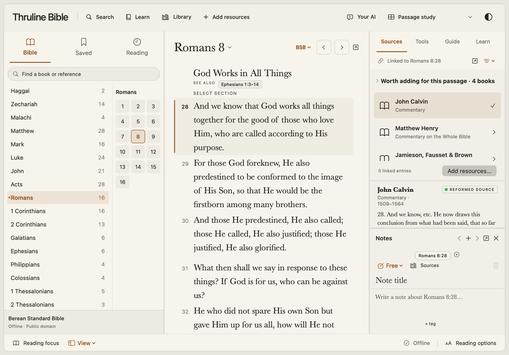

# Lectern

[](https://github.com/fastermatt/lectern/actions/workflows/checks.yml)
[](LICENSE)

A free, offline-first Bible study workspace for macOS. Scripture, sources and notes
stay together in a quiet, adjustable interface. No subscription or AI account is
required to study. The first public beta is [0.18.1](https://github.com/fastermatt/lectern/releases/tag/v0.18.1).



[View dark mode](docs/images/study-romans-dark.png)

## Our mission

Lectern exists to help anyone study the Christian Scriptures deeply without a
software subscription. The core workspace works offline and needs no account or AI
service. Scripture, historical sources and a reader's own notes belong together,
with sources and editions clear enough to verify. Readers can compare
interpretations, keep and export their work, and choose which resources to add.

We build Lectern as a community project. Readers, researchers, translators,
accessibility testers, writers and developers can improve it from anywhere. We
credit contributions and explain editorial decisions. We take historic Christian
teaching seriously: disputed or rejected claims need specific evidence and room
for correction, not a verdict based only on an author's name. AI output cannot
approve those claims. The official core remains free; optional third-party books
and AI services are separate choices.

## Start here

- **Use the app:** get the latest available beta from [Releases](https://github.com/fastermatt/lectern/releases). See [installation](docs/INSTALL.md); Apple Silicon/macOS 14+ only, currently unnotarized.
- **Build the app:** follow the commands below. All default resources are included.
- **Help without coding or a Mac:** report a reference error, suggest a resource,
  test accessibility or improve wording. Start with [Contributing](CONTRIBUTING.md)
  and [portable contribution drafts](collaboration/README.md).
- **Find a small task:** [good first issues](https://github.com/fastermatt/lectern/issues?q=is%3Aissue+is%3Aopen+label%3A%22good+first+issue%22) and [contributor roadmap](docs/ROADMAP.md).
- **Join the community:** [Discussions](https://github.com/fastermatt/lectern/discussions) or [help share maintenance](https://github.com/fastermatt/lectern/issues/5).

## What works today

Passage study with Bible, linked sources and notes; saved layouts; editable light/dark
palettes; Bible/library search; Strong's and original-language tools; the independently
sourced Apostolic Fathers reader; historic reference works; source/edition disclosures;
optional resource downloads and personal imports. Availability differs by passage.

Optional AI offers three local Qwen3.5 models (533 MB / 1.28 GB / 2.74 GB), downloaded
inside the packaged app, or a connection to your own compatible provider. Models run
without access to private notes or tools; readers explicitly attach context. AI can
be wrong and never approves theological labels. A read-only JSON CLI supports external
tools. See [AI and CLI](CLI-AND-AI.md) and [workspace guide](WORKSPACE-AND-LIBRARY.md).

## Build and test

Use a Mac with full Xcode and its Swift 6 toolchain, Python 3.9+, and Git. The current
beta and bundled local engine target **Apple Silicon, macOS 14+**. The local verification
record is in [Validation](docs/VALIDATION.md); the badge above links the current hosted CI result. Windows/Linux contributors can use the Python validators and edit docs/data.

```sh
git clone https://github.com/fastermatt/lectern.git
cd lectern
# Run inside your clone. Accept Xcode's license through Xcode if prompted.
export DEVELOPER_DIR=/Applications/Xcode.app/Contents/Developer
python3 scripts/verify-public-source.py
swift build
swift test
swift run StudyTable
```

No Obsidian vault, maintainer account, API key, model or upstream corpus download is
needed. `StudyTable` remains the internal module name to preserve compatibility.

To build an installable beta with the optional local engine:

```sh
python3 scripts/bootstrap-local-ai.py   # pinned 16.5 MB engine; no model weights
scripts/verify-content.sh
scripts/package-app.sh                 # writes Releases/Lectern-Beta-<version>.zip
```

The packager refuses to overwrite an existing release. Update Info.plist for a new
version. This produces an **ad-hoc signed, unnotarized** beta; it does not publish to
GitHub or provide automatic app updates. See [release instructions](docs/RELEASING.md).

## Resources and trust

Original code, tests and documentation are MIT licensed. Scripture, datasets, books
and assets keep their own terms; see [LICENSE](LICENSE), [content sources](CONTENT-SOURCES.md)
and [third-party notices](THIRD_PARTY_NOTICES.md). The included public-source profile
withholds mixed-rights HCF excerpts, private inputs and unverified legacy texture art.
The separate Apostolic Fathers reader remains included. See [PUBLIC-SOURCE.md](PUBLIC-SOURCE.md)
for exact scope, regional rights notices and the limits of corpus regeneration.

Source quotations, editorial interpretation and historical reception are distinct.
The app does not declare one fixed confessional identity; the reader can choose a
comparison lens. Source-based cautions remain visible. Disagreement with a chosen
tradition is not automatically a finding of heresy. Contributions to doctrinal labels
need primary evidence and human review; see [review process](GOVERNANCE.md).

## Contribute

Small pull requests are welcome. Explain the problem, show the result, and include the
checks you ran. You may use your own language; state the language so the right reviewer
can help. AI-assisted contributions need the same human verification as any other change.
Code, research, translation, testing and accessibility work all deserve credit.

Read [Contributing](CONTRIBUTING.md), [community conduct](CODE_OF_CONDUCT.md),
[security reporting](SECURITY.md) and [architecture](docs/ARCHITECTURE.md).
There is no promised response time or staffed editorial board yet. The contributor
roadmap includes recruiting independent maintainers so this project need not depend
on one person's availability.
